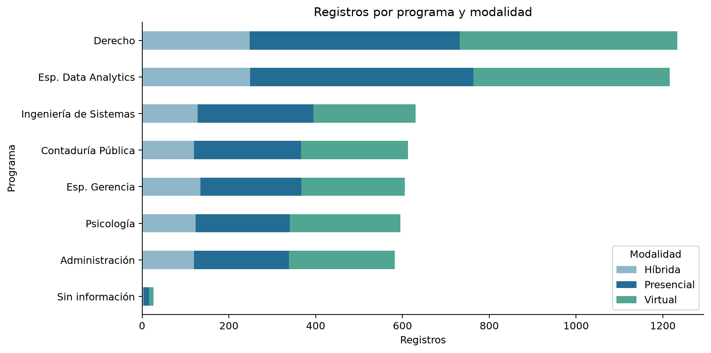
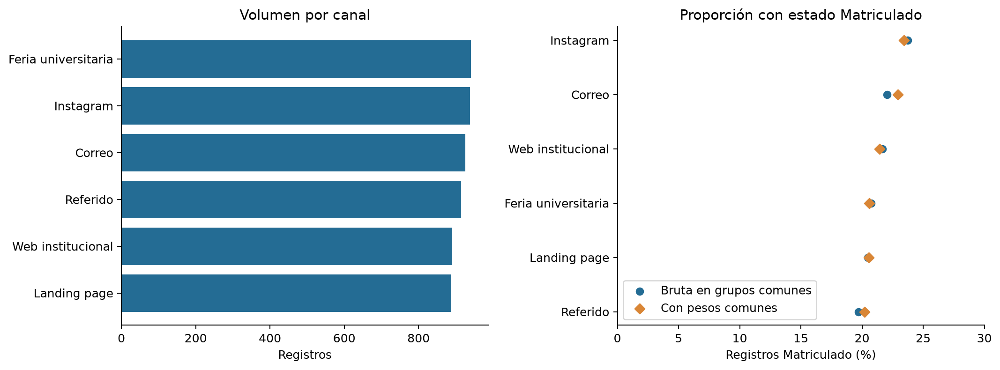
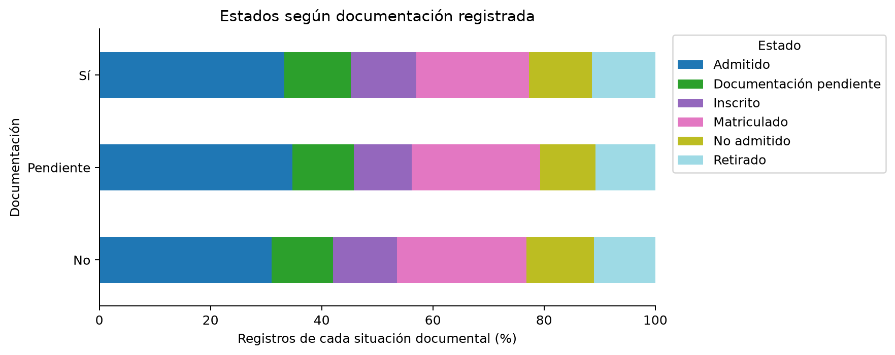

# Análisis de admisiones y oportunidades de mejora

## Guía para incorporar esta sección

Copiar desde Respuesta a la pregunta general hasta Prioridades para la gestión después de Limpieza y transformación. Conservar el análisis inicial de los 5.040 registros como antecedente. La sección actual corresponde a la base integrada de 5.500 registros y 18 columnas.

El apartado de las tres preguntas puede sustituir a Preguntas e hipótesis para el análisis posterior. Mantiene la hipótesis, la pregunta y la condición originales e incorpora la respuesta obtenida. Así se evita presentarlas como preguntas que todavía no se han examinado. Renumerar las figuras y la tabla al integrarlas y actualizar los índices al terminar la edición.

## Respuesta a la pregunta general

¿Cómo se distribuyen las solicitudes por programa, modalidad y canal, y qué se observa en los estados del proceso de admisión?

La base integrada reúne 5.500 registros de solicitudes. Derecho concentra 1.233 y Especialización en Data Analytics, 1.216. Juntos representan el 44,53 % del total, por lo que constituyen un foco relevante para revisar la capacidad de atención y la oferta disponible. Presencial y Virtual presentan participaciones similares, del 39,85 % y el 39,69 %, mientras Híbrida reúne el 20,45 %.

Los seis canales tienen volúmenes próximos, entre 888 y 941 registros. Feria universitaria aporta el mayor volumen, con 941, seguida de Instagram, con 939. La diferencia entre ambos es de dos registros. Por ello, el volumen por sí solo ofrece poca evidencia para priorizar un canal sobre otro.

Admitido es el estado más frecuente, con 1.822 registros, equivalentes al 33,13 %. Le siguen Matriculado, con 1.179 y el 21,44 %, Documentación pendiente, con 638 y el 11,60 %, Inscrito, con 630 y el 11,45 %, No admitido, con 617 y el 11,22 %, y Retirado, con 614 y el 11,16 %. Esta distribución describe la situación registrada. No representa un recorrido de las mismas personas por etapas ni permite considerar perdidas las solicitudes que aún no figuran como matriculadas.

Los resultados incluyen los 500 registros Oracle. Las posibles correspondencias entre fuentes permanecen identificadas, sin descartarlas por semejanza. En consecuencia, las cifras se refieren a registros de solicitudes y no a personas únicas o matrículas efectivas confirmadas.

Figura por numerar. Distribución de registros por programa y modalidad. Fuente: base integrada de 5.500 registros. Las cantidades representan solicitudes registradas, no personas únicas.

## Indicadores para el seguimiento administrativo

Los siguientes indicadores resumen la situación registrada y permiten orientar la revisión de casos. Constituyen una línea de referencia para la gestión. Sus metas y responsables deben acordarse con la institución antes de utilizarlos para evaluar el desempeño.

| Indicador | Cantidad y base de cálculo | Resultado | Lectura para la gestión |
| --- | --- | --- | --- |
| Registros en estado Matriculado | 1.179 de 5.500 | 21,44 % | Describe el resultado registrado. No equivale a conversión definitiva. |
| Solicitudes con asesor registrado | 4.399 de 5.500 | 79,98 % | Revisar la asignación y el seguimiento de los 1.101 registros restantes. |
| Documentación declarada completa | 3.285 de 5.500 | 59,73 % | Orienta la revisión documental. No acredita una verificación externa. |
| Matriculados con documentos No o Pendiente | 514 de 1.179 matriculados | 43,60 % | Confirmar las reglas de matrícula y la actualización documental. |
| Documentación pendiente con documentos Sí | 393 de 638 en ese estado | 61,60 % | Revisar si el estado o la documentación requieren actualización. |
| Registros en estado Retirado | 614 de 5.500 | 11,16 % | Requiere registrar motivos y fechas antes de explicar el retiro. |
| Disponibilidad del valor de matrícula | 4.580 de 5.500 | 83,27 % | Los 920 importes ausentes limitan el análisis económico. No se interpretan como cero. |

Tabla por numerar. Indicadores de seguimiento de la base integrada. Cada porcentaje utiliza la base de cálculo indicada. Los estados y la documentación corresponden a lo consignado en los registros.

Como apoyo, el 97,64 % dispone de correo y el 95,53 % de puntaje. Dentro de los 2.924 códigos de aspirante informados de la fuente principal, 1.363 aparecen en varias solicitudes, el 46,61 %. Esto exige distinguir solicitudes y aspirantes al presentar resultados. No constituye una tasa de retención ni confirma duplicación.

Entre los 1.035 registros cuyas fechas cumplen las reglas de comparación, la mediana entre solicitud y matrícula es de 33 días. Este resultado no mide el tiempo de primera atención ni la duración de cada etapa. El retorno de inversión, el retorno publicitario y el costo de adquisición no pueden calcularse sin gastos, ingresos y resultados atribuibles. Los importes de matrícula registrados no sustituyen los pagos efectivamente recibidos.

## Respuestas a las preguntas e hipótesis

### 1. Demanda registrada y matrícula por programa

Hipótesis: La participación de los programas y sus proporciones de matrícula pueden cambiar al resolver las repeticiones y agrupar las denominaciones equivalentes. Sin embargo, las diferencias de escritura observadas no permiten anticipar la magnitud ni la dirección de esos cambios.

Pregunta: Después de validar las solicitudes únicas y las matrículas efectivas, ¿cómo se distribuye la demanda por programa y qué proporción de las solicitudes llega a matrícula en cada periodo académico?

Condición para responder: Definir una solicitud única y una matrícula efectiva. El numerador y el denominador deben corresponder al mismo programa, periodo y ventana de seguimiento.

Respuesta con la información disponible: La concentración en Derecho y Data Analytics ya estaba presente antes de la limpieza. En la misma fuente, la conciliación de repeticiones deja sus participaciones prácticamente sin cambios, en el 22,26 % y el 22,54 %, respectivamente. La incorporación de Oracle explica que Derecho ocupe el primer lugar en la base integrada. El cambio de orden no demuestra crecimiento institucional.

En el conjunto integrado, Administración de Empresas registra 139 Matriculado de 582 solicitudes, el 23,88 %, y Contaduría Pública, 145 de 613, el 23,65 %. Derecho registra 251 de 1.233, el 20,36 %, y Data Analytics, 257 de 1.216, el 21,13 %.

Por periodo de ingreso, Data Analytics tiene el mayor volumen en el segundo semestre de 2025, con 231 registros y 55 Matriculado, el 23,81 % de sus solicitudes en ese periodo. Derecho encabeza el primero de 2026, con 518 y 103, el 19,88 %. Data Analytics vuelve a reunir el mayor volumen en el segundo de 2026, con 520 y 110, el 21,15 %. Estos ejemplos muestran por qué la evaluación debe conservar la separación por periodo, sin interpretar las diferencias como una tendencia temporal confirmada.

Alcance de la respuesta: Se responde la distribución registrada y se describe la matrícula consignada. La conversión definitiva solicitada en la pregunta sigue condicionada a confirmar solicitudes independientes, matrícula efectiva y un seguimiento equivalente. Para la gestión, conviene atender el volumen de Derecho y Data Analytics y revisar las diferencias por periodo antes de ampliar o reducir la oferta.

### 2. Diferencias entre canales de captación

Hipótesis: Las posibles diferencias en la proporción de registros matriculados entre canales podrían estar relacionadas con la composición de programas, modalidades y periodos que registra cada uno. Comparar grupos equivalentes permitirá evaluar si esas diferencias se mantienen.

Pregunta: Una vez validadas las solicitudes y las matrículas, ¿se mantienen las diferencias entre canales al comparar un mismo programa, modalidad y periodo académico?

Condición para responder: Utilizar la misma definición de matrícula, denominador y ventana de seguimiento para todos los canales. Una diferencia persistente no demostraría, por sí sola, que el canal sea su causa.

Respuesta con la información disponible: Instagram registra un 23,86 % de Matriculado y Referido, un 19,67 % en sus registros totales. Para comparar una composición equivalente de programas, modalidades y periodos se utilizaron 5.474 registros con programa identificado. Dentro de esos mismos grupos, la diferencia entre el canal con mayor y menor proporción pasa de 4,03 a 3,20 puntos porcentuales al dar a todos los canales una composición común.

Alcance de la respuesta: Las diferencias se reducen, pero no desaparecen. La composición de la oferta aporta parte de la explicación descriptiva, sin demostrar que un canal produzca mejores resultados. Algunas combinaciones tienen pocos registros y no se confirma una ventana uniforme de seguimiento. Antes de cambiar el presupuesto, conviene realizar pruebas con oferta y seguimiento comparables y registrar la inversión y el resultado atribuible a cada canal.

Figura por numerar. Volumen de registros y comparación de canales con una composición común. El panel comparativo utiliza 5.474 registros. Las diferencias no representan rentabilidad ni efectos causales del canal.

### 3. Documentación, asignación de asesor y estado del proceso

Hipótesis: La documentación incompleta y la ausencia de asesor asignado podrían estar asociadas con una mayor presencia de registros en documentación pendiente o retirados. La distribución actual no permite establecer una secuencia temporal ni atribuir esas situaciones a la gestión del asesor.

Pregunta: Después de validar las categorías y las solicitudes únicas, ¿cómo varía la distribución de estados según la documentación registrada y la asignación de asesor, dentro de un mismo programa, modalidad y periodo?

Condición para responder: Confirmar el significado y momento de actualización de cada columna. Para estudiar permanencia en una etapa o retiro posterior, se necesitarían fechas de cambio de estado y un historial de asignación de asesores.

Respuesta con la información disponible: Al comparar una composición común de programa, modalidad y periodo, los estados Documentación pendiente o Retirado representan el 21,92 % entre registros con documentos No o Pendiente y el 23,45 % con documentos Sí. Por tanto, no se observa el patrón general planteado para la documentación. Sin asesor asignado, esos estados representan el 23,36 %, frente al 22,68 % con asesor, una diferencia de 0,68 puntos porcentuales. La distribución de los seis estados se revisó dentro de los grupos y quedó respaldada en las tablas del análisis.

Alcance de la respuesta: Se describe la relación observada, sin confirmar solicitudes únicas ni el momento de actualización de cada columna. Los resultados no demuestran que los documentos incompletos favorezcan la matrícula ni permiten atribuir los estados a la actuación de un asesor. La prioridad administrativa es revisar los 514 matriculados con documentación No o Pendiente y los 393 registros en Documentación pendiente que indican documentos Sí, antes de interpretar esas diferencias como problemas de desempeño.

Figura por numerar. Distribución global de estados según documentación registrada. Esta figura muestra la comparación global. Los porcentajes con composición común citados en la respuesta proceden del análisis por programa, modalidad y periodo.

## Oportunidades de captación y seguimiento

Administración de Empresas virtual en Cali presenta 19 Matriculado entre 44 registros, el 43,18 %, y en Bogotá, 22 entre 66, el 33,33 %. Son combinaciones que justifican explorar campañas piloto si existe capacidad académica y de atención. Contaduría Pública presencial en Medellín presenta 13 entre 31, el 41,94 %, aunque su menor volumen exige especial prudencia. Se trata de oportunidades para comprobar, no de nichos rentables o desatendidos ya confirmados.

También aparecen combinaciones con volumen relevante que merecen revisar el seguimiento. Derecho virtual en Bogotá reúne 133 registros y 21 Matriculado, el 15,79 %. En Popayán, Derecho presencial presenta 13 entre 101, el 12,87 %, y Derecho virtual, 29 entre 106, el 27,36 %. Antes de atribuir estas diferencias a la modalidad, conviene revisar los periodos de ingreso, los estados y la composición de las fuentes. Las solicitudes todavía abiertas no deben contarse automáticamente como oportunidades perdidas.

## Prioridades para la gestión

Se propone comenzar por conciliar el estado documental de los casos señalados y comprobar la asignación efectiva de los 1.101 registros Sin asignar. Coordinación de admisiones y gestión documental podrían revisar estas situaciones y registrar la explicación o actualización correspondiente. Son responsabilidades propuestas que deben acordarse con la institución.

En captación, se propone evaluar un piloto acotado de Administración virtual en Cali y Bogotá y revisar el seguimiento de Derecho en las combinaciones identificadas. Cada acción debería definir un responsable, un plazo, una meta y una revisión posterior sobre grupos comparables. Así, el tablero de Power BI permitirá dar seguimiento a decisiones concretas y no solo mostrar cantidades.

La siguiente actualización debe distinguir lo observado de lo esperado. Para evaluar conversión definitiva, rentabilidad o tiempos de atención se requieren, respectivamente, solicitudes y matrículas verificadas, inversión e ingresos atribuibles, y fechas de los eventos del proceso. Estas necesidades delimitan la siguiente fase de medición sin impedir utilizar los resultados actuales para priorizar revisiones y pruebas controladas.
