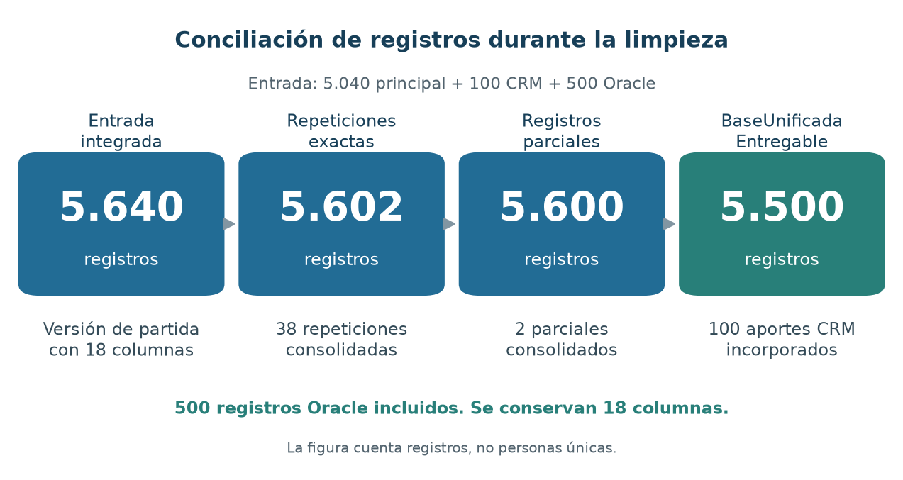

# Limpieza y transformación de la base unificada

## Verificación y preparación

La limpieza se realizó sobre los 5.640 registros y 18 columnas obtenidos después de integrar las fuentes y complementar el catálogo de programas. Se verificó su procedencia y se conservaron los archivos originales como respaldo. Los cambios quedaron registrados para identificar qué información se modificó y cuál fue su origen.

Se uniformaron las categorías y los tipos de información. Las fechas se representaron en formato de año, mes y día. Los valores económicos se conservaron en pesos colombianos y los periodos se homologaron como códigos de semestre de ingreso. Los valores no disponibles se mantuvieron como ausencias, sin sustituirlos por cero, promedios o categorías supuestas.

## Tratamientos aplicados

**Tabla 5. Síntesis de la limpieza y transformación**

| Aspecto | Tratamiento realizado | Resultado |
| :--- | :--- | :--- |
| Categorías y estados | Se unificaron variantes de escritura y Nuevo se agrupó analíticamente con Admitido. Matriculado permaneció separado y se conservó el estado recibido. | Categorías comparables, con el criterio de agrupación documentado. |
| Ausencias | Se homologaron los vacíos y marcadores de información no disponible. Pendiente en documentación y Sin asignar en asesor conservaron su significado. | Ausencias identificadas sin inventar valores. |
| Registros repetidos y parciales | Se consolidaron 38 repeticiones exactas y dos registros complementarios, recuperando cinco valores desde sus otras filas. | Se conservaron los vínculos con las entradas originales. |
| Información CRM | Se incorporaron 100 aportes a las solicitudes correspondientes. Se conservaron 87 importes principales y se recuperaron 13 desde matrícula base CRM. Los derechos administrativos quedaron separados. | Se evitó repetir las solicitudes y se recuperó información económica disponible. |
| Información Oracle | Se conservaron sus 500 registros. Las coincidencias con la principal se identificaron como candidatas, sin eliminarlas por semejanza. | Oracle permanece dentro de la base y del análisis integrado. |
| Fechas y periodos | Se conservaron los periodos como semestres de ingreso. Las fechas ambiguas y diferencias temporales se señalaron, sin recalcular automáticamente el periodo. | Cada indicador puede identificar qué registros cumplen sus reglas temporales. |

## Conciliación y comprobación del resultado

La Figura 5 muestra cómo cambió la cantidad de registros. La incorporación del CRM reúne información de solicitudes ya existentes. No representa la pérdida de 100 solicitudes diferentes. Los 500 registros Oracle permanecieron incluidos.

**Figura 5. Conciliación de registros durante la limpieza**

*Nota. Elaboración a partir del control de registros. Las cantidades corresponden a filas y no a personas únicas. La reducción reúne 38 repeticiones exactas, dos registros parciales y 100 aportes CRM incorporados a solicitudes existentes.*

La verificación final aprobó 23 controles, incluidos la conciliación de cantidades, la conservación de las fuentes y la lectura de los archivos exportados. Se obtuvo **BaseUnificada Entregable, con 5.500 registros y 18 columnas**, acompañada de diccionario, procedencia, metodología y controles de calidad.

Permanecen 26 registros sin programa, 90 sin identificador de aspirante, 246 sin puntaje y 920 sin importe. Estas ausencias no se completaron por suposición. También se conservaron las observaciones temporales y las correspondencias entre sistemas no confirmadas. Para el análisis se distingue el conteo de registros del conteo de identificadores de aspirante, evitando presentar varias solicitudes de una persona como personas nuevas.
