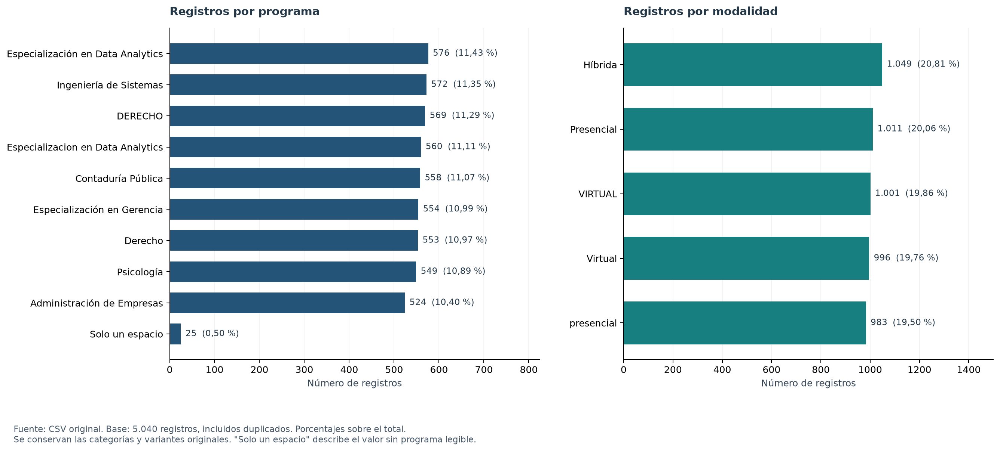
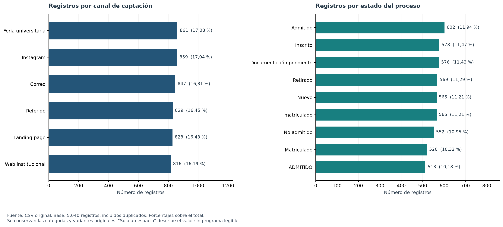
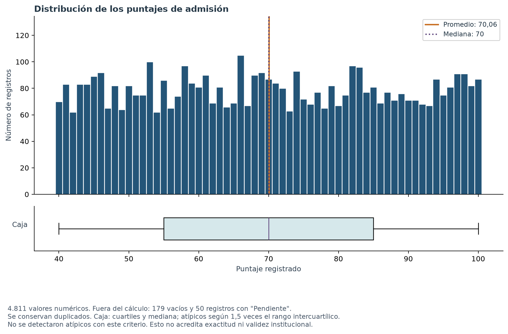
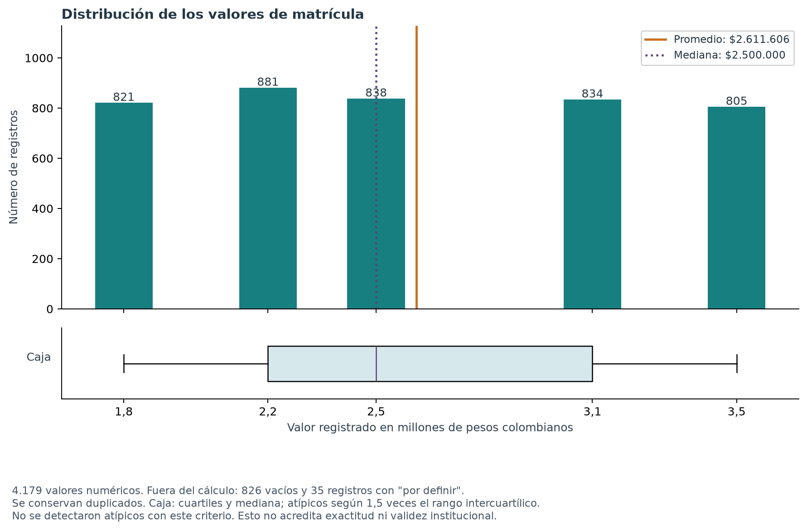
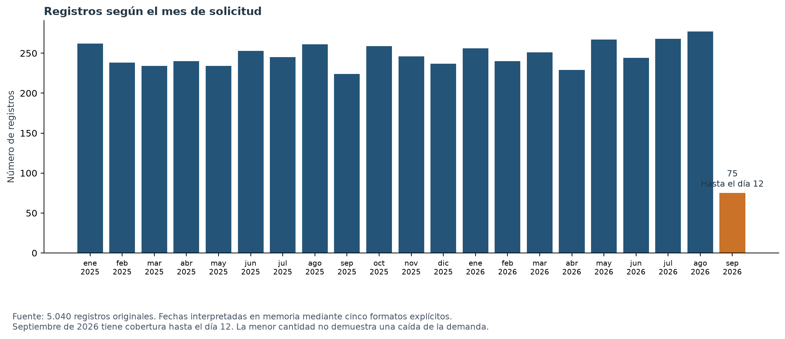
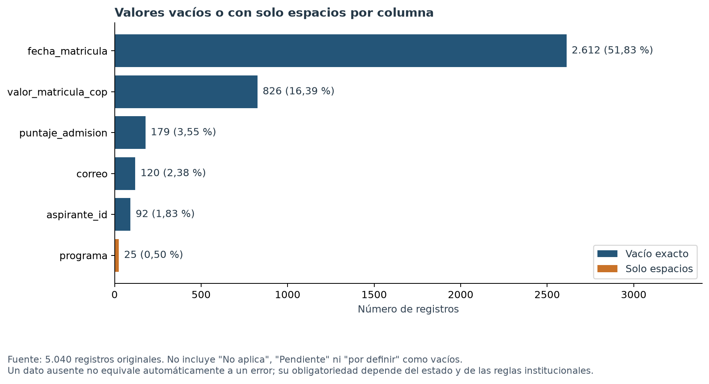

# Guía de gráficos para el informe administrativo

Las figuras se generan con `uv run analitica-admisiones graficar`. Cada una está disponible en PNG para insertar en el informe y en PDF para conservar calidad al ampliar. El CSV original permanece intacto. Los resultados numéricos y sus criterios se guardan en `estadisticas_graficos.json`.

## Cómo integrar el entregable

No se necesita un capítulo separado de gráficos. Cada figura debe aparecer junto a la pregunta, el resultado y su interpretación. Las tablas completas de frecuencias y el diccionario detallado pueden ir en anexos para respetar las 2 a 4 páginas sugeridas.

| Página sugerida | Contenido |
|---|---|
| 1 | Contexto, objetivo, reconocimiento del conjunto y diagnóstico resumido de calidad. El diccionario y la revisión completa de las 15 columnas quedan en anexos. |
| 2 | Distribuciones de programas, modalidades, canales y estados. Seleccionar las figuras 1 y 2 con sus explicaciones. |
| 3 | Distribución numérica de puntajes y valores de matrícula, figuras 3 y 4. Acompañar con sus estadísticas y denominadores. |
| 4 | Cinco hallazgos, limitaciones y tres preguntas posteriores. Si falta espacio para leer los gráficos con comodidad, llevar una figura categórica al anexo y mantener al menos tres visualizaciones en el cuerpo. |

Las figuras 5 y 6 son apoyos para anexos o pueden reemplazar una figura principal si el informe prioriza cobertura temporal o completitud. No se necesita repetir todas las tablas y gráficos sobre el mismo resultado.

## Figura 1. Programas y modalidades

Pregunta: ¿cómo se distribuyen los registros entre las denominaciones originales de programas y modalidades?

Las denominaciones de programas presentan conteos individuales entre 524 y 576 registros, además de 25 con un espacio como único contenido. Esa cercanía no permite concluir que todos los programas tengan una demanda equivalente: Derecho y Especialización en Data Analytics están fragmentados por diferencias de escritura. En modalidad también se observan variantes. El gráfico muestra las etiquetas originales sin homologarlas.

## Figura 2. Canales y estados

Pregunta: ¿por qué canales se registran las solicitudes y qué estados aparecen en el conjunto?

Los seis canales tienen entre 816 y 861 registros, con participaciones entre 16,19 % y 17,08 %. Esto describe un volumen parecido; no demuestra efectividad, rentabilidad o causalidad. Los estados se muestran con sus variantes originales y representan una distribución, no una secuencia histórica de cada persona. Los dos paneles muestran distribuciones separadas, no un cruce de canal con estado.

## Figura 3. Puntajes

Pregunta: ¿cómo se distribuyen los puntajes numéricos disponibles y se observan valores atípicos según el criterio definido?

Los 4.811 puntajes numéricos se encuentran entre 40 y 100. El promedio es 70,06 y la mediana 70. El histograma muestra la distribución por intervalos de un punto; el diagrama de caja permite revisar mediana, cuartiles y posibles extremos. No se detectaron atípicos con el criterio de 1,5 veces el rango intercuartílico. Esto no valida la escala institucional ni prueba que los datos sean correctos. Los 179 vacíos y 50 valores Pendiente no se incluyeron en el cálculo.

## Figura 4. Valores de matrícula

Pregunta: ¿qué importes se registran y cómo se distribuyen sus frecuencias?

Se registran cinco importes numéricos entre $1.800.000 y $3.500.000. Como los valores se repiten en importes específicos, las barras permiten distinguir su frecuencia mejor que una línea de tendencia. El promedio es $2.611.605,65 y la mediana $2.500.000. No se detectaron atípicos con el criterio exploratorio indicado, pero se requiere validar tarifas y excepciones por programa. Se utilizaron 4.179 valores; se excluyeron 826 vacíos y 35 por definir. No representan ingresos cobrados.

## Figura 5. Cobertura temporal, apoyo de anexo

Pregunta: ¿cómo se distribuyen los registros por mes de solicitud?

Las fechas interpretadas abarcan desde el 1 de enero de 2025 hasta el 12 de septiembre de 2026. Septiembre de 2026 tiene 75 registros y una cobertura parcial. Su menor volumen no demuestra caída de la demanda. El gráfico muestra registros originales con duplicados; no certifica que todos los meses anteriores estén completos ni que la fuente esté actualizada.

## Figura 6. Completitud, apoyo de anexo

Pregunta: ¿en qué columnas se concentran los valores vacíos o con solo espacios?

La fecha de matrícula concentra 2.612 vacíos, seguida del valor de matrícula con 826 y del puntaje con 179. El programa contiene 25 valores con solo espacios. El gráfico distingue vacío exacto y solo espacios, sin sumar No aplica, Pendiente o por definir como si fueran ausencias equivalentes. No todas las columnas tienen la misma obligatoriedad según el estado del proceso.

## Cinco hallazgos para el cierre

1. La información tiene condiciones de calidad que limitan los conteos únicos: se identificaron 38 repeticiones exactas adicionales y registros sin identificador de aspirante. No se eliminaron filas.
2. Las diferencias de escritura fragmentan programas, modalidades y estados, por lo que sus participaciones deben interpretarse como categorías originales hasta validar equivalencias.
3. Los canales presentan participaciones cercanas, entre 16,19 % y 17,08 % de las filas. Ese volumen no permite concluir cuál canal es más efectivo.
4. Los puntajes disponibles tienen promedio de 70,06 y mediana de 70; el valor de matrícula tiene promedio de $2.611.605,65 y mediana de $2.500.000. No hay atípicos bajo el criterio exploratorio usado, lo que no sustituye la validación institucional.
5. Al sumar las dos escrituras de matriculado solo para la lectura conjunta, se identifican 1.085 registros, de los cuales 465 tienen documentación No o Pendiente. La interpretación requiere confirmar las reglas de formalización.

## Tres preguntas después de limpiar y validar

1. Una vez confirmadas las claves y resueltas las repeticiones, ¿cuántas solicitudes y cuántos aspirantes únicos existen por programa, modalidad y periodo?
2. Tras validar los estados y las matrículas efectivas, ¿qué proporción de solicitudes llega a matrícula en cada canal, utilizando un denominador y una ventana temporal explícitos?
3. Después de validar fechas y documentación, ¿cómo se relaciona la disponibilidad de documentos con el tiempo transcurrido entre solicitud y matrícula?

## Distinción entre distribución y tendencia

Los histogramas, barras de importes y diagramas de caja describen distribuciones. Una tendencia temporal requiere un eje de tiempo y una comparación de periodos con cobertura adecuada. La ausencia de atípicos no elimina la necesidad de mostrar dispersión, concentración y valores centrales.
