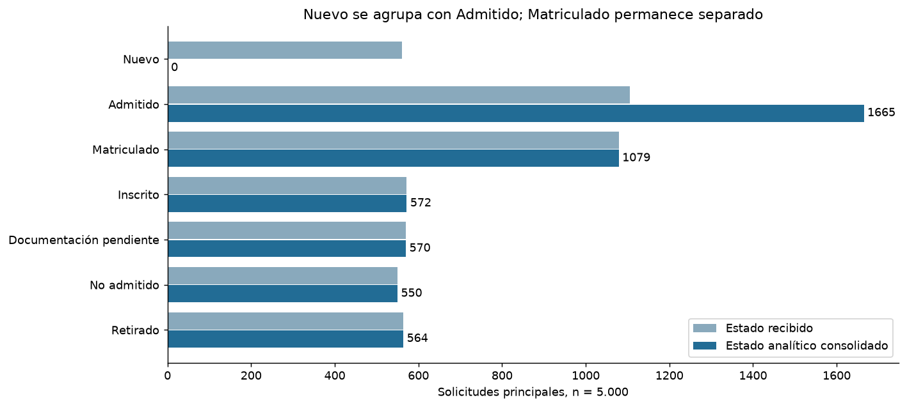
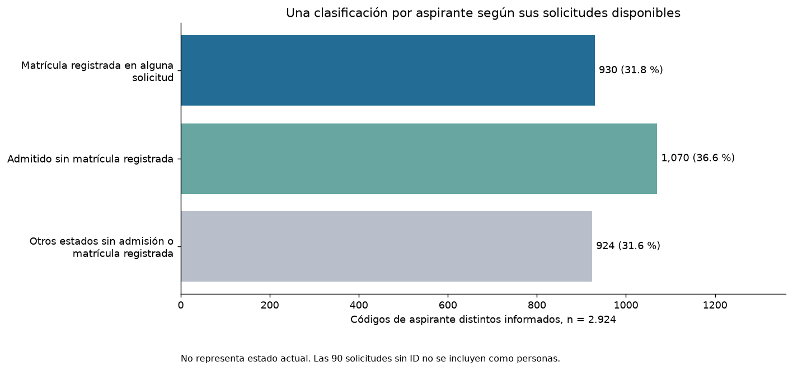

# Estados, aspirantes y cierre de limpieza

Revisión del 26 de octubre de 2026.

## Decisión sobre Nuevo

El usuario aclaró que Nuevo describe a una persona que ya ingresó y comenzará estudios. Para el análisis se adopta Nuevo como Admitido, conservando el estado recibido en la auditoría. En la principal, ninguno de los 560 Nuevo tiene fecha de matrícula, mientras que los 1.079 Matriculado sí la tienen. La ausencia de fecha no demuestra una equivalencia institucional; la agrupación es un criterio de trabajo que incorpora el contexto del usuario. No se infieren pagos ni matrículas formalizadas.

Se mantienen 5.600 registros y 18 columnas. Cambian 620 celdas de estado: 560 principales, nueve CRM y 51 Oracle. Admitido pasa de 1.105 a 1.665 solicitudes principales; Matriculado conserva 1.079. No se elimina una solicitud por reclasificarla.

## Riesgo de doble conteo

La fuente principal tiene 5.000 códigos de solicitud distintos, 2.924 códigos de aspirante informados distintos y 90 solicitudes sin código de aspirante. Son unidades distintas. Las gráficas anteriores estaban denominadas como solicitudes; para responder cuántas personas hay debe usarse la vista por aspirante.

| Comprobación en la principal | Resultado |
| :--- | ---: |
| Códigos con varias solicitudes | 1.363 |
| Códigos con varios estados originales | 1.205 |
| Códigos con varios estados después de consolidar Nuevo | 1.158 |
| Códigos presentes en varios programas | 1.210 |
| Códigos presentes en varios periodos | 966 |

Si se suman los aspirantes distintos de cada estado original se obtienen 4.474 pertenencias a categorías. Tras agrupar Nuevo con Admitido se obtienen 4.371. Ninguna suma equivale a los 2.924 códigos únicos. Consolidar etiquetas reduce categorías, pero no resuelve por sí solo la repetición de una persona en distintas solicitudes.

## Vistas disponibles para analizar sin inflar personas

| Vista | Filas | Uso |
| :--- | ---: | :--- |
| BaseUnificada_Revision | 5.600 | Consolidado con las tres fuentes y trazabilidad. No sumar como solicitudes o personas nuevas. |
| Principal_Analisis | 5.000 | Demanda y solicitudes de la fuente principal, una fila por registro_id. |
| Aspirantes_Principal | 2.924 | Una fila por aspirante_id informado; recurrencia, programas y estados observados. |
| Solicitudes_Sin_ID | 90 | Solicitudes cuya persona no puede contarse con certeza. No equivalen a 90 personas ni se agrupan como una sola persona. |

La clasificación por aspirante es excluyente y suma exactamente 2.924: primero quienes tienen alguna solicitud Matriculado, después quienes tienen Admitido y ninguna Matriculado, y finalmente los demás. Describe evidencia en cualquiera de sus solicitudes disponibles, sin afirmar el estado actual ni una secuencia de transiciones.

| Clasificación por aspirante | Códigos distintos | Porcentaje de 2.924 |
| :--- | ---: | ---: |
| Matrícula registrada en alguna solicitud | 930 | 31.81 % |
| Admitido sin matrícula registrada | 1.070 | 36.59 % |
| Otros estados sin admisión o matrícula registrada | 924 | 31.60 % |

## Solicitudes repetidas y evolución del estado

Hay 48 grupos con el mismo aspirante, programa, modalidad y periodo, que incluyen 96 solicitudes. En 39 grupos aparecen distintos estados originales. Se exportan para revisión. No hay prueba de que todos sean versiones de una misma solicitud; por eso no se borran por compartir aspirante.

La base tiene fecha de solicitud y fecha de matrícula, pero no fecha de actualización del estado. Por tanto, no permite elegir con certeza el último estado ni reconstruir una trayectoria completa. Una persona con Matriculado en un programa y Retirado en otro no debe reclasificarse globalmente como si ambos eventos fueran el mismo proceso.

## Resumen del trabajo documentado

| Trabajo | Resultado |
| :--- | :--- |
| Integración | 5.640 entradas y 18 columnas, con procedencia de principal, CRM y Oracle. |
| Estandarización | Catálogos, tildes, espacios, tipos, fechas ISO, importes COP y periodos enteros. |
| Ausencias | Motivos conservados; 94 identificadores no informados homologados a null, incluidos cuatro nan. |
| Repeticiones exactas | 38 filas adicionales consolidadas con vínculo al representante. |
| Parciales | REG003600 y REG004804 resueltos: cinco celdas recuperadas y dos filas consolidadas. |
| Exploración L10 | Siete gráficos y tablas por programa, modalidad, canal, ciudad, estados, importes y fechas. |
| Estados L11 | Nuevo agrupado como Admitido; Matriculado conservado; 620 originales registrados por celda. |
| Unidad de análisis L11 | Vistas de solicitudes y aspirantes separadas, con reglas de conteo y 90 solicitudes sin ID aparte. |

Los puntos de control L09 y L10 se conservan como históricos. El estado vigente de estados y personas está en reports/limpieza/ultima_identidad_estados.json. Las tablas auxiliares no aumentan las 18 columnas de la tabla administrativa.

## Qué falta para cerrar la sesión de limpieza

| Prioridad | Acción concreta | Criterio de cierre |
| :--- | :--- | :--- |
| 1 | Conciliar los 100 CRM por solicitud y concepto económico. | Confirmar matrícula base como medida, recuperar los 13 importes disponibles y mantener derechos y origen en auditoría. |
| 2 | Resolver la política Oracle. | Establecer si será fuente de contraste o si sus candidatos se integrarán mediante correspondencias documentadas. No sumar sus 500 códigos como personas nuevas. |
| 3 | Aplicar reglas temporales a cada indicador. | Conservar fechas y periodos, señalar las alertas y declarar los subconjuntos utilizados; no inventar actualizaciones de estado. |
| 4 | Cerrar el tratamiento de los 90 casos sin ID. | Mantenerlos aparte o adoptar una regla explícita de recuperación con la evidencia interna; no inventar personas. |
| 5 | Aprobar los indicadores y congelar la versión. | Totales por unidad, controles de destinos, estados originales auditados y un único resumen vigente para el análisis. |

No se recomienda completar matrícula por programa o modalidad: las 63 combinaciones de programa, modalidad y periodo de la principal contienen los cinco valores observados. Tampoco eliminar aspirante_id, porque permite este control de recurrencia y conteo.

Pasaron 17 controles de la nueva etapa, con lectura completa de CSV, JSONL y las hojas principales de Excel. Las fechas, importes, identificadores y otros atributos conservan sus valores. No se modificaron fuentes ni tablas Docker.

## Gráficos actualizados

## Documentación y respaldo

Datos: `data/processed/taller_2/identidad_estados_v1_3973db4f87_b26d6f5b_0122a31c_78fc6490`.

Auditoría: `reports/limpieza/ejecuciones/identidad_estados_v1_3973db4f87_b26d6f5b_0122a31c_78fc6490`.

La auditoría contiene cambios de estado, correspondencias de las 5.640 entradas, grupos para revisión de historial, comparación entre solicitudes y aspirantes, frecuencias con ambos conteos y un diccionario de indicadores y denominadores. El notebook principal reproduce todas las etapas. Los conteos por programa, canal, modalidad o estado pueden solaparse entre aspirantes y no deben sumarse como un total de personas.
