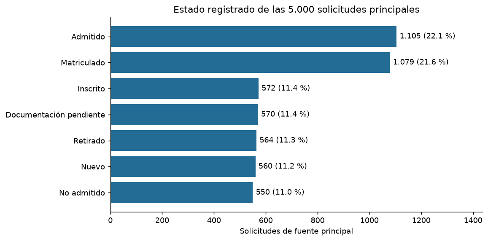
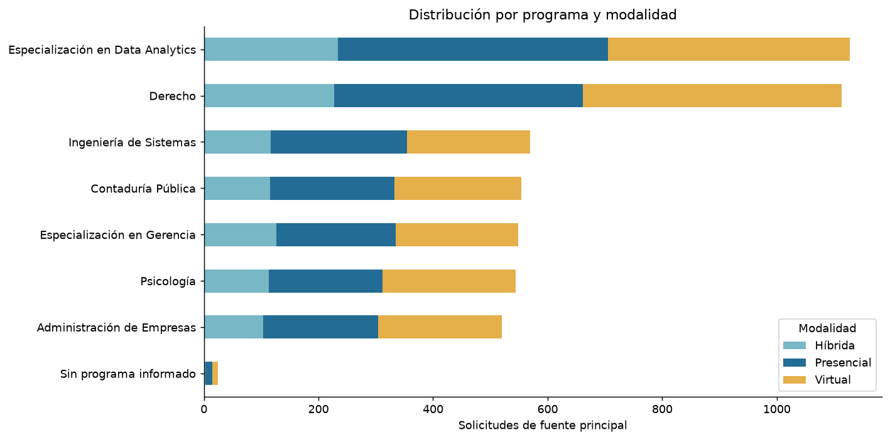
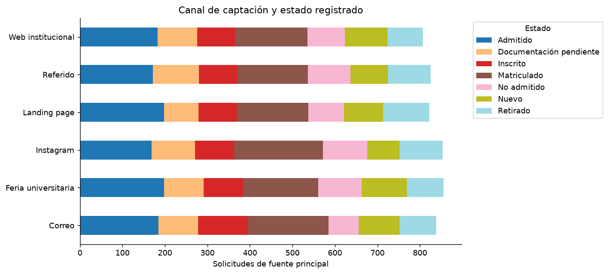
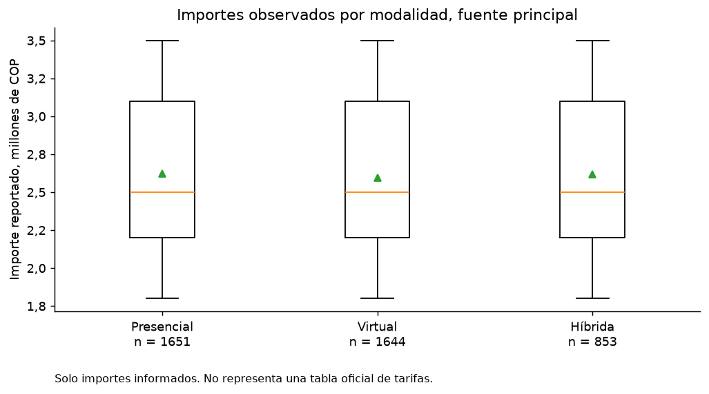
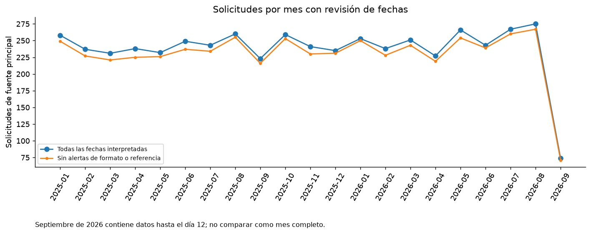
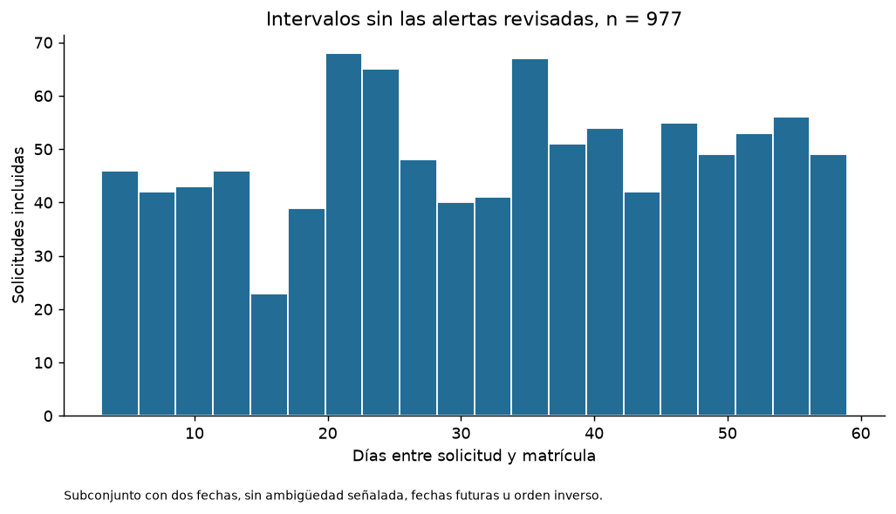
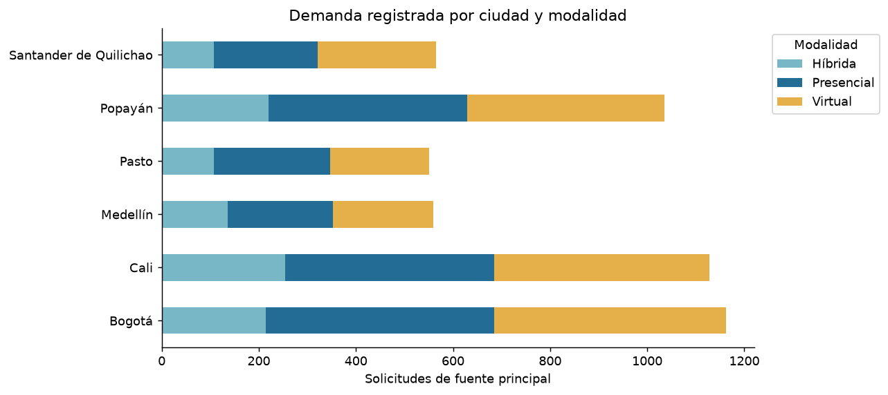

# Revisión descriptiva y avance de limpieza

Fecha: 26 de octubre de 2026.

**Resultado:** los dos registros parciales se complementaron y consolidaron. El consolidado conserva 5.600 registros y 18 columnas. La fuente principal contiene 5.000 códigos de solicitud distintos; CRM aporta 100 registros solapados y Oracle 500 registros con correspondencias candidatas. Las comparaciones administrativas siguientes utilizan la fuente principal, sin sumar CRM y Oracle como solicitudes adicionales.

## 1. Qué se corrigió

| Solicitud | Tratamiento |
| :--- | :--- |
| REG003600 | Se recuperó 1.800.000 COP de su otra fila y se consolidaron las dos entradas. |
| REG004804 | Se recuperaron Ingeniería de Sistemas, Ingeniería, 8 semestres y Pregrado desde su otra fila, y se consolidaron ambas entradas. |

Se comprobó la igualdad de todos los demás atributos, incluido el código de solicitud, antes de complementar las ausencias. Se recuperaron cinco celdas y se consolidaron dos filas; no se imputaron promedios ni se eligió entre valores informados contradictorios. La auditoría mantiene el destino de las 5.640 entradas originales.

Se homologaron como ausencias reales 94 identificadores no informados, incluidos 4 textos nan. Son null en JSONL, None en Python y celdas vacías en Excel. Se conserva el marcador original y su motivo en L10_ausencias_identificadores.csv. No se eliminó ninguna solicitud por esta normalización y se conservaron los códigos informados.

## 2. Estados: Nuevo no se reclasifica como Admitido

Las fuentes utilizan ambas etiquetas y no contienen un diccionario que las declare equivalentes. La presencia de puntaje o documentos completos tampoco demuestra admisión. Se conservan los siete estados y se ofrece una agrupación auxiliar para presentar el proceso, sin afirmar transiciones.

| Estado registrado | Solicitudes principales | Porcentaje | Fase auxiliar de presentación |
| :--- | ---: | ---: | :--- |
| Admitido | 1.105 | 22.10 % | Admisión registrada |
| Matriculado | 1.079 | 21.58 % | Matrícula registrada |
| Inscrito | 572 | 11.44 % | Gestión inicial |
| Documentación pendiente | 570 | 11.40 % | Gestión inicial |
| Retirado | 564 | 11.28 % | Retirado |
| Nuevo | 560 | 11.20 % | Gestión inicial |
| No admitido | 550 | 11.00 % | No admitido |

Hay 351 solicitudes con estado Documentación pendiente y documentos Sí, y 462 con estado Matriculado y documentos No o Pendiente. Son discrepancias para seguimiento, no una regla para sustituir automáticamente el estado. También podrían reflejar estados o documentos actualizados en momentos distintos; esa explicación es una hipótesis.

## 3. Importes por programa, modalidad y periodo

Las 63 combinaciones de programa identificado, modalidad y periodo de la fuente principal contienen cinco importes distintos. Ninguna tiene una tarifa única deducible. No se puede completar una matrícula solo porque otra solicitud tenga el mismo programa y modalidad.

| Modalidad | Importes informados | Ausentes | Promedio COP | Mediana COP |
| :--- | ---: | ---: | ---: | ---: |
| Virtual | 1.644 | 337 | 2.595.620,44 | 2.500.000,00 |
| Presencial | 1.651 | 329 | 2.624.348,88 | 2.500.000,00 |
| Híbrida | 853 | 186 | 2.616.178,19 | 2.500.000,00 |

En las 21 comparaciones dentro de un mismo programa y periodo, la mediana virtual es menor en 1, igual en 18 y mayor en 2. Esto describe los importes disponibles y no acredita que una modalidad tenga una tarifa más baja. No se aplicó imputación por modalidad.

CRM conserva un concepto distinto: base más derechos administrativos. Sus importes se describen por separado. La comprobación anterior encontró 87 matrículas principales iguales a la base CRM y 13 principales ausentes recuperables desde la base CRM; esa conciliación económica es una regla pendiente de aplicar y no forma parte de las cinco celdas recuperadas aquí.

## 4. Las fechas de matrícula sí aportan

En la fuente principal, los 1.079 registros con estado Matriculado tienen fecha de matrícula y no se observan fechas de matrícula en otros estados. Por ello la columna aporta información para estudiar cuándo se registra la matrícula y el intervalo frente a la solicitud.

Se detectan 165 fechas de solicitud con formato ambiguo señalado y 0 matrículas anteriores a la solicitud. El resumen de intervalos utiliza 977 casos sin las alertas revisadas y deja fuera del cálculo 102; estos últimos permanecen en la base. La mediana del subconjunto es 33 días. No representa un tiempo promedio institucional validado.

La fuente principal llega hasta 2026-09-12. Septiembre de 2026 termina en el día 12: una caída de su conteo no demuestra una caída mensual de demanda. Oracle tiene otra cobertura temporal y no se mezcla en esta serie. Las fechas no se intercambiaron ni se ajustaron a un periodo supuesto.

## 5. Aporte de aspirante_id

Los 5.000 códigos de solicitud principales contienen 2.924 códigos de aspirante informados distintos. Hay 90 solicitudes sin código de aspirante y 1.363 códigos presentes en varias solicitudes. Solicitud y aspirante son unidades diferentes.

Entre los identificadores ausentes, 62 tienen un único código candidato en otras filas con el mismo correo. Esa coincidencia se exporta para revisión y no se aplica como prueba de identidad. Se conserva aspirante_id en el respaldo y se omite de las agrupaciones de mercado; borrarlo impediría revisar recurrencia y procedencia.

## 6. Lectura administrativa y oportunidades de análisis

Los cruces de programa, modalidad y ciudad permiten describir dónde se concentra la demanda registrada. Los cruces de canal y estado permiten ubicar solicitudes en gestión inicial o con matrícula registrada. Sus cantidades y proporciones se exportan con el denominador de cada grupo.

Una concentración de solicitudes identifica interés observado. Para llamarla oportunidad comercial conviene considerar también costos, capacidad y campañas, que no están disponibles. La proporción de registros Matriculado por canal no mide por sí sola la eficacia causal ni una conversión comercial definitiva. Los datos disponibles tampoco permiten reconstruir cuánto duró cada etapa del proceso, porque no hay fechas de transición de estado.

Preguntas útiles: ¿qué combinaciones de programa, modalidad y ciudad concentran solicitudes? ¿Qué canales concentran gestión inicial y matrícula registrada? ¿Dónde hay estados y documentación discordantes? ¿Cómo cambian las fechas de matrícula dentro del subconjunto sin alertas? ¿Qué solicitudes repiten código de aspirante?

## 7. Qué queda pendiente para la versión definitiva

| Tema | Siguiente tratamiento |
| :--- | :--- |
| CRM | Aprobar y aplicar la conciliación de 100 correspondencias y el concepto económico antes de recuperar los 13 importes. |
| Oracle | Acordar la regla de identidad para integrar sus candidatos; conservarlo separado del volumen principal mientras tanto. |
| Fechas y periodos | Conservar valores, indicar casos no elegibles para cada cálculo y resolver solo con evidencia interna suficiente. |
| Estados y catálogo | Mantener denominaciones actuales; usar agrupaciones auxiliares explícitas. No convertir Nuevo en Admitido. |
| Vacíos | Mantener ausencias no recuperables. No completar importes por programa o modalidad sin una regla sustentada. |

Pasaron 15 controles, incluida la lectura completa de CSV, Excel y JSONL. Los estados, códigos informados, fechas e importes ajenos a REG003600 conservan sus valores; los identificadores no informados se representan como null. La salida permite continuar análisis descriptivo por fuente; la identidad global y los conceptos económicos todavía requieren reglas de cierre.

## Gráficos

### Estados registrados

### Programas y modalidades

### Canales y estados

### Importes por modalidad

### Solicitudes por mes

### Intervalos de matrícula revisados

### Ciudades y modalidades

## Archivos de respaldo

Datos: `data/processed/taller_2/revision_descriptiva_v1_9fbbe58562_b04de70c_03c823d0_cedd9608`.

Auditoría y tablas descriptivas: `reports/limpieza/ejecuciones/revision_descriptiva_v1_9fbbe58562_b04de70c_03c823d0_cedd9608`.

El resumen vigente está en reports/limpieza/ultima_revision_descriptiva.json. Los controles auxiliares no aumentan las 18 columnas de negocio. La base de cierre L09 conserva su condición de punto de control histórico; esta revisión L10 es su actualización para los dos parciales. No se modificaron las tablas Docker.
